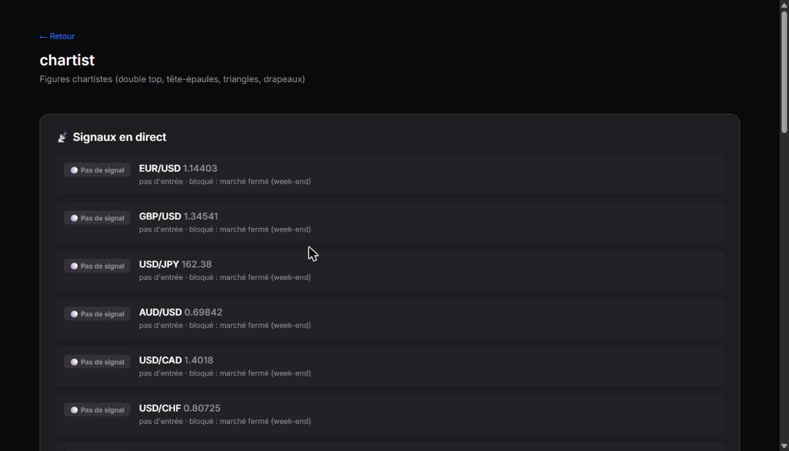
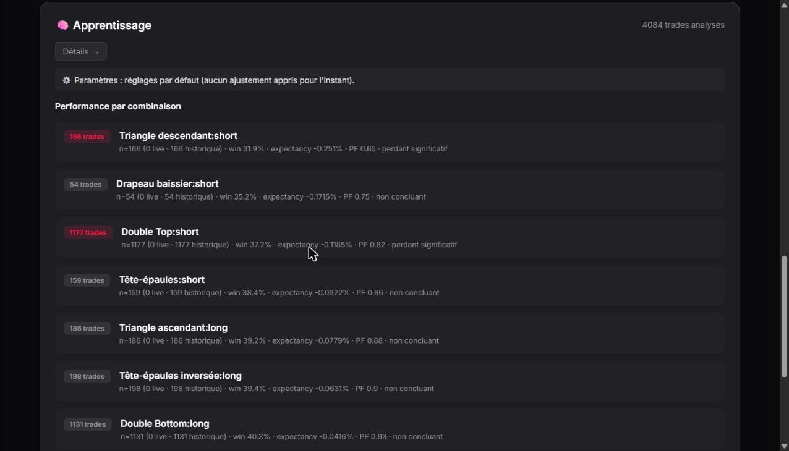
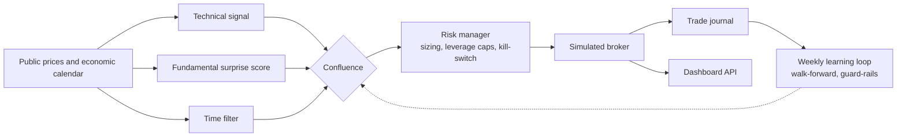

# Laboratoire de trading forex multi-signaux

*[English version](README.md)*

[](https://github.com/figtitou-svg/trading_view/actions/workflows/ci.yml)     

Une plateforme de recherche et de **paper trading** forex : une bibliothèque de bots à règles, une chaîne de validation statistique (event study, walk-forward), une boucle d'auto-réglage hebdomadaire, un miroir de copy trading simulé et un dashboard web.

> **Aucun argent réel n'est jamais en jeu.** Les prix viennent d'un feed public (yfinance), il n'y a aucune intégration de broker et chaque exécution est calculée localement. C'est un projet d'ingénierie et de recherche, pas un conseil financier.

## Captures d'écran



*Signaux en direct d'un bot : chaque paire est évaluée, et ici le filtre temporel bloque les entrées car le marché est fermé pour le week-end.*



*La barrière statistique à l'œuvre sur plus de 4 000 trades historiques : chaque combinaison reçoit un verdict (« perdant significatif », « non concluant »). Une combinaison qui ne passe pas n'est pas promue — c'est le but de la chaîne de validation.*

## Architecture en un coup d'œil



## Points forts techniques

- **Pas de look-ahead par construction.** Le surprise score n'utilise que des annonces antérieures, et les paramètres ne sont jugés que hors échantillon (walk-forward).
- **Une barrière statistique avant tout paper trading.** La confluence doit battre la technique seule, l'event study doit être significatif (t-test de Welch et bootstrap) et le walk-forward rester positif.
- **Des bots en plug-in.** Un fichier dans `forex/strategies/` = un bot, découvert par un registre, livré avec un test isolé.
- **Une boucle d'auto-réglage sous garde-fous.** Les paramètres ne bougent qu'après un cycle walk-forward et un échantillon minimum ; chaque changement est journalisé et réversible.
- **Des coûts réalistes partout** (spread, slippage, swap, plafonds de levier ESMA) et 450+ tests. Aucun ordre réel n'est possible.

## Contenu

| Partie | Rôle |
| --- | --- |
| **`forex/`** | Le cœur. Signaux (technique, « surprise score » fondamental, filtre temporel), règle d'entrée par **confluence**, gestion du risque (taille en pips, plafonds de levier ESMA, coupe-circuit de drawdown jour/semaine), moteur de backtest avec coûts réalistes, broker simulé |
| **`forex/strategies/`** | Un fichier = un bot, découvert automatiquement par un registre : tendance, chartiste, smart money, macro, news sniper, momentum de séries temporelles, croisement de moyennes, cassure de canal / de Londres, or macro, momentum Nasdaq, cassure pétrole, et combinaisons |
| **`forex/backtest/`** | Moteur événementiel, **event study** (rendements anormaux cumulés, t-test de Welch, bootstrap), optimisation **walk-forward**, rapport comparatif vs technique seule et buy & hold |
| **`forex/learning/`** | Boucle de rétroaction hebdomadaire : mesure chaque combinaison de signaux dans le journal des trades, ré-optimise les paramètres par walk-forward sous garde-fous, désactive une combinaison qui se dégrade et réactive celle qui reprend — chaque changement est journalisé et réversible |
| **`copytrading/`** | Un portefeuille miroir simulé de traders Hyperliquid : présélection automatique (taille de compte, ROI 7 j positif, activité), poche virtuelle égale par trader suivi, levier jamais répliqué |
| **`api/` + `dashboard/`** | Backend FastAPI (routeurs v1/v2, couche d'agrégation en cache où tous les calculs statistiques sont faits) et dashboard statique |
| **`tests/`** | 50+ modules de tests : stratégies, risque, backtest, apprentissage, copy trading, API |

## L'idée centrale : la confluence, validée avant de trader

Une position n'est ouverte que lorsque **tous les signaux actifs s'accordent** :

1. **Technique** — tendance (MA 50/200), momentum (MACD) et filtre RSI.
2. **Fondamental** — un *surprise score* : `(réel − consensus) / écart-type des surprises passées` du même type d'annonce, calculé **uniquement sur les annonces antérieures** (pas de look-ahead).
3. **Filtre temporel** — marché fermé le week-end, pas de nouvelle position autour des annonces à fort impact, sortie forcée d'un trade événementiel qui n'a pas payé.

Chaque signal est désactivable pour mesurer sa contribution marginale. Avant tout paper trading, un rapport vérifie que la confluence bat la technique seule **et** que l'event study est statistiquement significatif **et** que le walk-forward reste positif hors échantillon.

## Démarrage

```bash
python -m venv .venv && source .venv/bin/activate     # Windows : . .venv/Scripts/activate
pip install -r requirements.txt
cp .env.example .env                                  # facultatif : notifications Telegram, clé FRED
pytest tests/ -v
```

```bash
python -m forex.data.calendar --refresh               # construit l'historique local du calendrier économique
python -m forex.backtest.report --pair EUR_USD --granularity H1   # rapport de validation
python -m forex.paper.runner --once                   # une itération de paper trading (sans --once : en boucle)
python -m copytrading.runner --once                   # une itération de copy trading
uvicorn main:app --port 8000                          # dashboard sur http://localhost:8000/dashboard
```

Sous Windows, `scripts/start.bat` lance les runners et le dashboard d'un coup.

## Ajouter un bot

Un bot est un seul fichier dans `forex/strategies/` — rien d'autre à modifier :

```python
# forex/strategies/mon_bot.py
from forex.strategies.base import Strategy, StrategyDecision

class MonBotStrategy(Strategy):
    id = "mon-bot"
    label = "Description courte"
    min_candles = 60
    pairs = ["USD_JPY"]        # optionnel : restreint aux paires listées (défaut : toutes)

    def decide(self, pair, now, candles, events, context=None):
        ...
        return StrategyDecision(True, "long", 0.8, ["raison"], {"setup": "mon-setup"})
```

Désactive-le avec `enabled = False`, purge son historique avec `python -m forex.strategies.remove --bot mon-bot` (`--archive` pour renommer), et ne lance que certains bots avec `FOREX_BOTS=smc,macro` dans `.env`. Chaque bot a un test qui exerce `decide()` isolément (voir `tests/test_forex_smc.py`).

## Particularités du forex gérées

Marché 24/5 avec alerte de gap de week-end · taille en pips (0.0001, ou 0.01 sur les paires JPY) · units dérivées du risque en % et de la distance du stop · plafonds de levier ESMA (30:1 majeures, 20:1 mineures/or) · swap overnight modélisé dans le backtest · spread et slippage inclus dans chaque résultat.

## Déploiement

Voir [`docs/deployment.md`](docs/deployment.md) : unités systemd pour le runner forex, le dashboard, le runner de copy trading et le timer d'apprentissage hebdomadaire. Le dashboard n'a pas d'authentification — à garder sur un réseau privé.

## Technologies

Python · FastAPI · pandas · NumPy · SciPy · yfinance · pytest · systemd

## Licence

[MIT](LICENSE)
