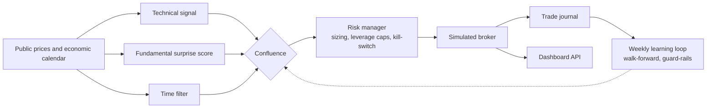

# Forex Multi-Signal Trading Lab

*[Version française](README.fr.md)*

[](https://github.com/figtitou-svg/trading_view/actions/workflows/ci.yml)     

A research and **paper-trading** platform for forex: a library of rule-based bots, a statistical validation pipeline (event study, walk-forward), a weekly self-tuning loop, a simulated copy-trading mirror, and a web dashboard.

> **No real money is ever involved.** Prices come from a public feed (yfinance), there is no broker integration and every fill is computed locally. This is an engineering and research project, not financial advice.

## Architecture at a glance



## Engineering highlights

- **No look-ahead by construction.** The surprise score only uses earlier announcements, and parameters are only ever judged out of sample (walk-forward).
- **A statistical gate before any paper trading.** Confluence must beat technical-only, the event study must be significant (Welch t-test and bootstrap), and walk-forward must stay positive.
- **Plug-in bots.** One file in `forex/strategies/` is one bot, auto-discovered by a registry, each shipped with an isolated test.
- **A self-tuning loop with guard-rails.** Parameters move only after a walk-forward cycle and a minimum sample; every change is logged and reversible.
- **Realistic costs everywhere** (spread, slippage, overnight swap, ESMA leverage caps) and 450+ tests. No real order can ever be placed.

## What is in it

| Part | What it does |
| --- | --- |
| **`forex/`** | The core. Signals (technical, fundamental "surprise score", time filter), a **confluence** entry rule, risk management (pip-based sizing, ESMA leverage caps, daily/weekly drawdown kill-switch), a backtest engine with realistic costs, and a simulated broker |
| **`forex/strategies/`** | One file = one bot, auto-discovered by a registry: trend, chartist, smart-money concepts, macro, news sniper, time-series momentum, MA crossover, channel/London breakout, gold macro, Nasdaq momentum, oil breakout, and combinations |
| **`forex/backtest/`** | Event-driven engine, **event study** (cumulative abnormal returns, Welch t-test, bootstrap), **walk-forward** optimisation, comparison report vs technical-only and buy & hold |
| **`forex/learning/`** | Weekly feedback loop: measures each signal combination from the trade journal, re-tunes parameters by walk-forward under guard-rails, disables a degrading combination and re-enables a recovering one — every change is logged and reversible |
| **`copytrading/`** | A simulated mirror portfolio of Hyperliquid traders: automatic candidate pre-selection (account size, positive 7-day ROI, activity), equal virtual pocket per followed trader, leverage never replicated |
| **`api/` + `dashboard/`** | FastAPI backend (v1/v2 routers, a cached aggregation layer where all statistics are computed) and a static dashboard |
| **`tests/`** | 50+ test modules covering strategies, risk, backtest, learning, copy-trading and the API |

## The core idea: confluence, validated before trading

A position is opened only when **all active signals agree**:

1. **Technical** — trend (MA 50/200), momentum (MACD) and an RSI filter.
2. **Fundamental** — a *surprise score*: `(actual − consensus) / stdev of past surprises` for that release type, computed **only from earlier announcements** (no look-ahead).
3. **Time filter** — market closed on weekends, no new position around high-impact releases, forced exit of an event-driven trade that did not pay.

Each signal can be switched off to measure its marginal contribution. Before any paper trading, a report checks that confluence beats technical-only **and** that the event study is statistically significant **and** that walk-forward stays positive out of sample.

## Getting started

```bash
python -m venv .venv && source .venv/bin/activate     # Windows: . .venv/Scripts/activate
pip install -r requirements.txt
cp .env.example .env                                  # optional: Telegram notifications, FRED key
pytest tests/ -v
```

```bash
python -m forex.data.calendar --refresh               # build the local economic-calendar history
python -m forex.backtest.report --pair EUR_USD --granularity H1   # validation report
python -m forex.paper.runner --once                   # one paper-trading iteration (omit --once to loop)
python -m copytrading.runner --once                   # one copy-trading iteration
uvicorn main:app --port 8000                          # dashboard on http://localhost:8000/dashboard
```

On Windows, `scripts/start.bat` starts the runners and the dashboard in one go.

## Adding a bot

A bot is a single file in `forex/strategies/` — nothing else to edit:

```python
# forex/strategies/my_bot.py
from forex.strategies.base import Strategy, StrategyDecision

class MyBotStrategy(Strategy):
    id = "my-bot"
    label = "Short description"
    min_candles = 60
    pairs = ["USD_JPY"]        # optional: restrict to these pairs (default: all)

    def decide(self, pair, now, candles, events, context=None):
        ...
        return StrategyDecision(True, "long", 0.8, ["reason"], {"setup": "my-setup"})
```

Disable it with `enabled = False`, purge its history with `python -m forex.strategies.remove --bot my-bot` (`--archive` to rename instead), and run only some bots with `FOREX_BOTS=smc,macro` in `.env`. Every bot ships with a test that exercises `decide()` in isolation (see `tests/test_forex_smc.py`).

## Forex specifics handled

24/5 market hours with weekend-gap alerts · pip-based sizing (0.0001, or 0.01 on JPY pairs) · units derived from the risk percentage and the stop distance · ESMA leverage caps (30:1 majors, 20:1 minors/gold) · overnight swap modelled in the backtest · spread and slippage included in every result.

## Deployment

See [`docs/deployment.md`](docs/deployment.md): systemd units for the forex runner, the dashboard, the copy-trading runner and the weekly learning timer. The dashboard has no authentication — keep it on a private network.

## Tech

Python · FastAPI · pandas · NumPy · SciPy · yfinance · pytest · systemd

## License

[MIT](LICENSE)
